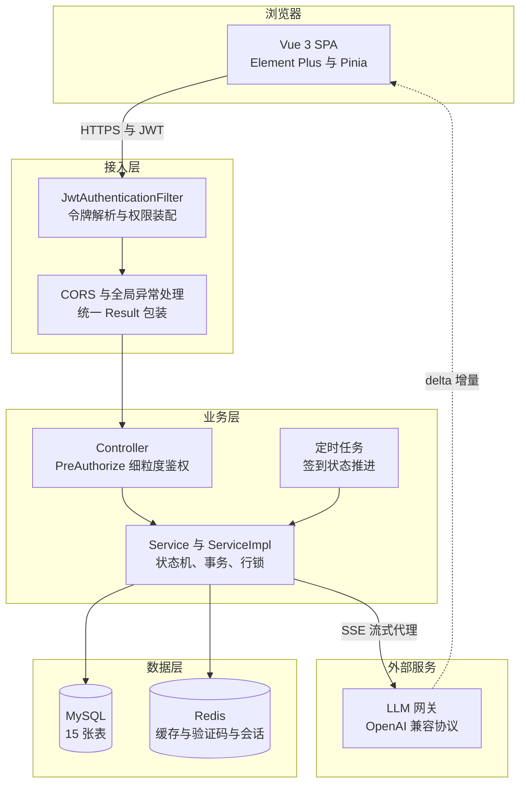
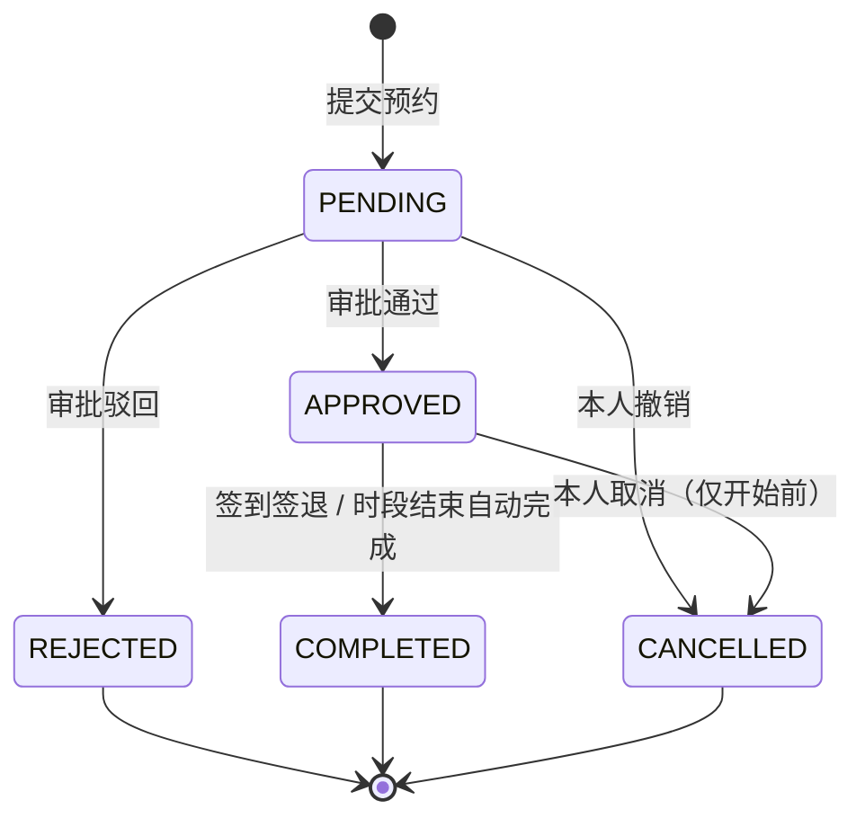
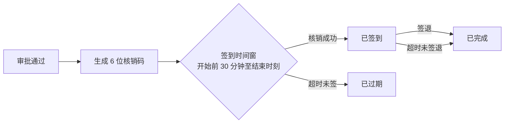
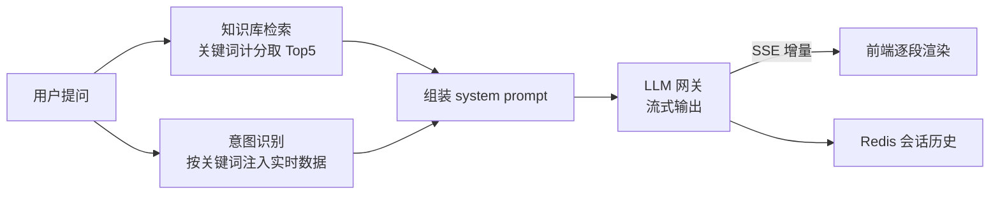

# 智慧实验室预约管理系统 · LabWise

面向高校实验室的预约与运行管理平台，覆盖 **预约申请 → 审批 → 签到核销 → 设备报修** 的完整业务闭环，并提供实时占用看板、数据驾驶舱与内置 AI 助手。


---

## 目录

- [项目简介](#项目简介)
- [功能特性](#功能特性)
- [技术栈](#技术栈)
- [系统架构](#系统架构)
- [快速开始](#快速开始)
- [默认账号](#默认账号)
- [配置说明](#配置说明)
- [核心业务设计](#核心业务设计)
- [数据库设计](#数据库设计)
- [项目结构](#项目结构)
- [接口概览](#接口概览)
- [接口测试](#接口测试)
- [部署](#部署)
- [版本里程碑](#版本里程碑)

---

## 项目简介

传统实验室排期依赖人工登记与线下沟通，容易出现三类问题：**时段冲突无法及时发现**、**设备带病使用导致实验事故**、**预约后无人到场造成资源空转**。

本项目以「预约单」为核心对象，把排期、审批、到场、归还串成一条可追溯的状态链：

- 提交预约时做**六重校验**（开放状态、时间合法性、开放时段、容量、设备故障锁定、时段冲突）
- 审批环节做**职责分离**，教师单只能由管理员审批，且任何人不能审批自己的单
- 审批通过自动签发**6 位核销码**，到场核销、离场签退，超时未签到由定时任务自动归为过期
- 任一设备故障即**锁定整间实验室**，防止带病使用
- 所有状态流转都会推送**站内消息**，并在审批环节留痕

面向 4 类角色：学生、教师、实验室管理员、超级管理员，权限通过 RBAC 模型细粒度控制到按钮。

---

## 功能特性

### 面向学生 / 教师

| 功能 | 说明 |
| --- | --- |
| 预约申请 | 选择实验室、日期、时段、用途与人数，可指定设备；提交即进入待审核 |
| 我的预约 | 查看本人全部预约与状态，仅在预约开始前可取消（含原因） |
| 我的签到 | 查看本人核销码、签到记录，支持签退 |
| 设备报修 | 选择故障设备提交报修，跟踪受理 / 维修 / 完成进度 |
| 消息中心 | 接收预约、报修、账号三类站内通知，未读红点提醒 |
| 个人中心 | 维护资料、头像与密码，查看个人统计 |

### 面向教师（额外）

| 功能 | 说明 |
| --- | --- |
| 审批学生预约 | 在预约管理页通过或驳回学生提交的预约 |
| 签到核销 | 输入学生出示的核销码完成现场签到（**看不到核销码本身**，防止提前泄露） |
| 发送站内消息 | 向学生、教师或实验室定向/批量发送消息 |
| 自行预约 | 教师也可提交实验室预约（该单只能由管理员审批） |
| 设备报修 | 可提交报修并查看报修工单进度；维修处理仍由实验室管理员负责 |

### 面向管理员

| 功能 | 说明 |
| --- | --- |
| 实验室台账 | 维护实验室编号、类型、位置、容量、开放开关、可预约开关 |
| 开放时段配置 | 按星期（周一至周日）为每间实验室配置可预约时段与人数上限 |
| 设备台账 | 维护设备编号、型号、数量、价格、运行状态与故障状态 |
| 报修闭环 | 受理报修、填写处理意见、完成闭环 |
| 预约管理 | 全量预约查询、审批、导出 Excel |
| 用户管理 | 注册审核、启用/禁用、重置密码、分配角色 |
| 角色与权限 | 角色维护、权限树分配 |
| 操作日志 | AOP 记录操作人、请求参数、耗时与结果 |
| 数据驾驶舱 | 总量指标、热门实验室、预约趋势、状态分布、类型分布 |

### AI 助手（全角色可用）

- 自然语言问答，回答以 **SSE 流式** 打字机效果呈现，支持随时停止生成
- **知识库检索**：19 条业务知识（预约规则、审批权限、签到核销、开放时段、报修流程、角色权限、FAQ 等）按提问关键词计分命中，Top5 注入提示词
- **实时数据注入**：按提问意图自动带入实验室占用、统计概览、热门排行、我的预约/签到/报修/消息，管理员额外注入待审批与待处理报修
- 会话上下文存 Redis，保留最近 20 条、24 小时过期
- 内置限流（20 次/分钟）与单用户并发流互斥

### 通用体验

| 功能 | 说明 |
| --- | --- |
| 顶栏时钟与天气 | 实时日期时间；右侧显示和风天气实况（自动定位，拒绝授权/无法定位时回落广州） |
| 消息主动推送 | 新站内消息触发浏览器系统通知，点击直达消息中心；未授权通知权限时退回页内弹窗 |
| 深色 / 浅色主题 | iOS 风格雾透玻璃质感，主题偏好本地持久化 |

> 天气由后端代理和风天气接口，**API Key 只存在于服务器环境变量**，前端拿不到；
> 实况按经纬度在 Redis 缓存 10 分钟，刷新页面不会反复消耗接口配额。

---

## 技术栈

### 后端

| 组件 | 版本 | 用途 |
| --- | --- | --- |
| JDK | 25（字节码目标 24） | 语言运行时 |
| Spring Boot | 3.4.0 | 应用框架 |
| Spring Security | 6 | 认证授权 |
| JJWT | 0.12.6 | JWT 签发与校验 |
| MyBatis-Plus | 3.5.7 | ORM、分页、逻辑删除、乐观锁 |
| MySQL | 8.x | 关系型数据库 |
| Redis | 7.x | 登录缓存、权限缓存、统计缓存、验证码、AI 会话 |
| 和风天气 API | v7 / GeoAPI | 顶栏实时天气与经纬度反查城市（服务端代理） |
| Knife4j | 4.5.0 | OpenAPI 3 接口文档 |
| Apache POI | 5.3.0 | Excel 导出 |
| Hutool | 5.8.32 | 通用工具 |
| Lombok | 1.18.48 | 代码简化 |

### 前端

| 组件 | 版本 | 用途 |
| --- | --- | --- |
| Vue | 3.5 | 组合式 API |
| Vite | 5.4 | 构建工具 |
| Element Plus | 2.8.4 | UI 组件库 |
| Pinia | 2.2 | 状态管理 |
| Vue Router | 4.4 | 路由 |
| ECharts | 5.5 | 图表可视化 |
| Axios | 1.7 | HTTP 客户端 |
| marked + DOMPurify | 18 / 3.4 | AI 回答的 Markdown 渲染与 XSS 净化 |
| Sass | 1.79 | 样式预处理 |

---

## 系统架构



**请求链路要点**

- 前端所有请求经 Axios 拦截器携带 `Authorization: Bearer <token>`
- `JwtAuthenticationFilter` 解析令牌后优先读 Redis 权限缓存，未命中回源数据库重建
- 业务异常统一包装为 `HTTP 200 + body.code != 200`，前端按 `code` 分流提示
- AI 对话不走 Axios：`fetch` + `ReadableStream` 手动解析 SSE（`EventSource` 无法自定义请求头）

---

## 快速开始

### 环境要求

| 依赖 | 版本要求 |
| --- | --- |
| JDK | 25（编译目标 24，需 JDK 24+ 才能编译） |
| Maven | 3.9+ |
| Node.js | 18+ |
| MySQL | 8.0+ |
| Redis | 6.0+ |

### 1. 初始化数据库

```bash
mysql -uroot -p < sql/mysql.sql
```

脚本会创建 `lab_reservation` 库、全部表结构与种子数据（4 角色、52 项权限、6 个账号、16 间实验室、416 条开放时段、设备台账）。脚本可重复执行。

已初始化过旧版本的库，按版本号依次执行增量脚本：

```bash
mysql -uroot -p lab_reservation < sql/upgrade_v1.1.sql
# ... 按版本号依次执行至最新增量脚本
```

### 2. 启动 Redis

```bash
redis-server
```

未设置密码时，配置里 `spring.data.redis.password` 留空即可。

### 3. 启动后端

```bash
# 提供数据库密码（不要写进配置文件）
export DB_PASSWORD="你的MySQL密码"      # Windows PowerShell: $env:DB_PASSWORD="..."

# 可选：启用顶栏天气（不配置时天气自动隐藏，其余功能不受影响）
export QWEATHER_KEY="你的和风天气 Key"

mvn -DskipTests package
java -jar target/lab-reservation-system.jar --spring.profiles.active=dev
```

运行单元测试（状态机等纯逻辑，不依赖 Spring 上下文与数据库）：

```bash
mvn test
```

后端默认监听 `http://localhost:8080`，接口前缀 `/api`。

接口文档（Knife4j）：开发环境 `http://localhost:8080/doc.html`。
**生产环境默认关闭**（`springdoc.api-docs.enabled=false`、`knife4j.enable=false`），
需要临时查看时在服务器 `.env` 设 `SPRINGDOC_ENABLED=true` / `KNIFE4J_ENABLED=true` 后重启。

### 4. 启动前端

```bash
cd frontend
npm install
npm run dev
```

开发服务器启动在 `http://localhost:8081`，Vite 已配置代理把 `/api` 转发到 `http://localhost:8080`，无需额外跨域配置。

生产构建：

```bash
npm run lint      # ESLint（Vue essential 规则，0 error 才允许合并）
npm run build     # 产物在 frontend/dist
```

格式化：`npm run format`（Prettier 配置见 `frontend/.prettierrc.json`）。

> 生产环境接口地址由构建期变量 `VITE_API_BASE` 注入，见 `frontend/.env.production`。

---

## 默认账号

种子数据中的账号密码均为 `123456`（BCrypt 存储）：

| 用户名 | 姓名 | 角色 | 说明 |
| --- | --- | --- | --- |
| `admin` | 系统管理员 | 超级管理员 | 全部权限 |
| `labadmin` | 张管理 | 实验室管理员 | 实验室、设备、审批 |
| `teacher` | 李教授 | 教师 | 审批 + 核销 + 发送消息 |
| `teacher2` | 王教授 | 教师 | 同上，用于验证「教师单只能管理员审批」 |
| `student` | 张三同学 | 学生 | 预约与报修 |
| `student2` | 李四同学 | 学生 | 同上，用于验证时间冲突 |

> 生产环境请立即修改默认密码。

---

## 配置说明

所有敏感配置均通过环境变量注入，仓库内不含真实凭据。

| 变量 | 默认值 | 说明 |
| --- | --- | --- |
| `SPRING_PROFILES_ACTIVE` | `dev` | 环境标识，生产用 `prod` |
| `SERVER_ADDRESS` | `0.0.0.0` / 生产为内网地址 | 监听地址 |
| `PORT` | `8080` / 生产 `8091` | 监听端口 |
| `DB_HOST` | `localhost` | MySQL 主机 |
| `DB_PORT` | `3306` | MySQL 端口 |
| `DB_NAME` | `lab_reservation` | 数据库名 |
| `DB_USER` | `root` | 数据库账号 |
| `DB_PASSWORD` | 空 | 数据库密码（**必须外部提供**） |
| `REDIS_HOST` | `localhost` | Redis 主机 |
| `REDIS_PORT` | `6379` | Redis 端口 |
| `REDIS_PASSWORD` | 空 | Redis 密码 |
| `JWT_SECRET` | 开发占位值 | 令牌签名密钥（**生产必须替换**） |
| `AI_BASE_URL` | 内置网关地址 | OpenAI 兼容协议基址 |
| `AI_TOKEN` | 空 | 模型访问令牌，为空时 AI 功能降级提示 |
| `AI_MODEL` | `MiniMax-M2.5` | 模型名称 |
| `AI_TIMEOUT` | `60` | 上游空闲超时（秒） |
| `CORS_ALLOWED_ORIGINS` | `http://localhost:8081,http://localhost:5173` | 跨域来源白名单（逗号分隔，**禁止填 `*`**） |
| `CAPTCHA_EXPOSE_CODE` | `false` | 是否在验证码接口回传验证码本身；仅无短信通道的演示环境可临时开启 |
| `QWEATHER_HOST` | `https://na5u9xkk3k.re.qweatherapi.com` | 和风天气 API Host（顶栏天气） |
| `QWEATHER_KEY` | 空 | 和风天气 API Key（**仅服务端注入**，缺失时顶栏天气自动隐藏） |

> 验证码即登录凭证，`CAPTCHA_EXPOSE_CODE=true` 时任何知道账号的人都能匿名取码登录，
> 生产环境接入短信通道后**必须保持 `false`**。

---

## 核心业务设计

### 预约状态机



- 合法流转由 `ReservationStatus.canTransition()` 集中约束，非法跳转在 Service 层直接拦截
- `REJECTED` / `COMPLETED` / `CANCELLED` 为终态
- **草稿、已取消、已驳回不占用时段**，不阻塞他人预约
- **已通过的单据一旦到达开始时间即不可取消**，避免过期预约被「取消」篡改历史
- 定时任务每 5 分钟把「结束时刻已过且仍为已通过」的预约推进为已完成，状态不再长期失真

### 六重预约校验

| 顺序 | 校验项 | 失败提示 |
| --- | --- | --- |
| 1 | 实验室开放且允许预约 | 该实验室已被禁止预约 / 未开放 |
| 2 | 日期不早于今天、结束晚于开始 | 参数错误 |
| 3 | 时段被当天某个启用时段完整包含 | 不在开放时间段内 |
| 4 | 使用人数不超过容量 | 预约人数超过实验室容量 |
| 5 | 实验室无故障设备；指定设备属于该实验室且无故障 | 实验室已锁定 / 设备故障中 |
| 6 | 与既有有效预约无区间交集 | 时间冲突（返回冲突单号） |

### 时间冲突算法

两个半开区间 `[a, b)` 与 `[c, d)` 冲突的充要条件是存在交集：

```
a < d  AND  b > c
```

判定在 Mapper 层完成（`selectConflictingReservations`），并按状态过滤掉草稿、已取消、已驳回的单据。

**并发安全**：提交前对实验室行加锁，把「先查后插」串行化。配合 `TRANSACTION_READ_COMMITTED` 隔离级别，加锁后的校验必定读到最新已提交数据，避免两人同时约到同一时段。

### 审批权限矩阵

| 提交人 | 可审批人 | 说明 |
| --- | --- | --- |
| 学生 | 教师、实验室管理员、超级管理员 | 具备 `reservation:approve` 即可 |
| 教师 | 仅超级管理员、实验室管理员 | 其他教师无权批准教师单 |
| 任何人 | 不能审批自己的单 | 职责分离 |

审批通过后自动：生成 6 位核销码 → 推送通知 → 写入审批流水（审批人、动作、意见、时间）。

### 签到核销闭环



- 核销码仅**预约本人**与**超级管理员**可见；教师只能现场输入，防止提前泄露
- 定时任务每 5 分钟扫描：超时未签到 → 已过期并通知；已签到未签退 → 自动完成
- 签退后同步把预约单置为「已完成」，闭合整条链路

### 设备故障锁定

只要实验室下存在任意一台 `fault_status = 1` 的设备，整间实验室立即锁定、拒绝新预约；审批通过前还会再复核一次，防止审批期间设备突发故障。

### AI 助手



工程上的几个关键处理：

| 问题 | 处理方式 |
| --- | --- |
| 上游会先输出 `delta.reasoning`（思考过程） | 只转发 `delta.content`，跳过推理内容 |
| 长回答被总时长限制截断 | 看门狗改为**空闲超时**：连续 60 秒无任何数据才中断，另设 10 分钟总时长兜底 |
| `readLine()` 阻塞导致无法自检 | 守护线程在超时后关闭输入流，让阻塞读取抛出退出 |
| Tomcat 默认 8KB 响应缓冲攒批 | `response.setBufferSize(1)`，保证打字机效果 |
| 容器异步超时硬掐长连接 | `spring.mvc.async.request-timeout: 400s`，`SseEmitter` 360s |
| SSE 结束触发二次派发被鉴权拦截 | 放行 `DispatcherType.ASYNC` 与 `ERROR` |
| 模型输出 Markdown / 可能含脚本 | marked 渲染 + DOMPurify 净化后再 `v-html` |

---

## 数据库设计

共 15 张表（14 张业务表 + 1 张 AI 知识库表），全部使用 InnoDB + utf8mb4。

| 表名 | 说明 | 关键字段 |
| --- | --- | --- |
| `sys_user` | 用户 | `username` 唯一、`password` BCrypt、`status` 0禁用/1启用/2待审核 |
| `sys_role` | 角色 | `role_code`：SUPER_ADMIN / LAB_ADMIN / TEACHER / STUDENT |
| `sys_permission` | 权限与菜单 | `perm_code` 如 `reservation:submit`、`perm_type` 1菜单/2按钮 |
| `sys_user_role` | 用户-角色 | 多对多 |
| `sys_role_permission` | 角色-权限 | 多对多 |
| `lab_info` | 实验室 | `lab_code` 唯一、容量、`open_status`、`enable_reserve` |
| `lab_time_slot` | 开放时段 | `week_day` 1-7、`start_time`/`end_time`、`max_people` |
| `lab_reservation` | 预约单 | `reservation_no` 唯一、状态、驳回/取消原因、`complete_time` |
| `lab_approval` | 审批流水 | 审批人、动作、意见、时间（预留多级审批） |
| `device` | 设备台账 | `device_code` 唯一、`status`、`fault_status`、`quantity` |
| `device_repair` | 报修单 | 状态机 PENDING → REPAIRING → COMPLETED |
| `lab_checkin` | 签到核销 | `checkin_code` 6 位唯一、签到/签退时间、核销人 |
| `sys_notice` | 站内消息 | 类型 SYSTEM / RESERVATION / REPAIR、`read_flag` |
| `sys_oper_log` | 操作日志 | 操作人、IP、参数、耗时、异常信息 |
| `ai_knowledge` | AI 知识库 | `category`、`keywords`、`content`、`priority`、`status` |

**通用约定**：业务实体统一继承 `BaseEntity`，含雪花主键、`deleted` 逻辑删除、`create_time` / `update_time` 自动填充。新增表若缺少这三列，逻辑删除会直接报 500。

---

## 项目结构

```
lab-reservation-system/
├── src/main/java/com/lab/reservation/
│   ├── aop/            操作日志切面（注解 + 环绕通知）
│   ├── common/         统一响应、分页、基础实体、错误码
│   ├── config/         安全、Redis、MyBatis-Plus、Jackson、AI、天气、Knife4j
│   ├── constant/       Redis Key 常量集中管理
│   ├── controller/     16 个 REST 控制器
│   ├── dto/            请求参数对象（含校验注解）
│   ├── entity/         15 个数据库实体
│   ├── enums/          预约/签到/报修状态机、消息类型
│   ├── exception/      业务异常、全局异常处理、AI 流中止信号
│   ├── mapper/         MyBatis-Plus Mapper + 自定义查询
│   ├── security/       JWT 过滤器、工具类、登录用户、处理器
│   ├── service/        业务接口
│   ├── serviceImpl/    业务实现（状态机、事务、行锁、缓存）
│   └── vo/             视图对象
├── src/main/resources/
│   ├── application.yml         公共配置
│   ├── application-dev.yml     开发环境
│   ├── application-prod.yml    生产环境
│   └── mapper/                 复杂 SQL 的 XML
├── frontend/
│   ├── src/api/                接口封装
│   ├── src/components/         通用组件
│   ├── src/layout/             布局、侧边菜单
│   ├── src/router/             路由与守卫
│   ├── src/store/              Pinia 用户状态
│   ├── src/styles/             全局样式与主题变量
│   ├── src/utils/              请求、SSE、主题、图表、倒计时
│   └── src/views/              20 个页面 + 4 个看板组件（登录、驾驶舱、预约、签到、报修、AI…）
├── sql/                        建库脚本 + 14 个增量升级脚本
├── postman/                    Postman 接口测试集合与环境变量
├── deploy/tailnet/             systemd 单元、静态服务脚本、部署说明
└── pom.xml
```

---

## 接口概览

所有接口以 `/api` 为前缀，统一返回：

```json
{ "code": 200, "message": "操作成功", "data": {} }
```

业务失败时 **HTTP 状态仍为 200**，通过 `code` 区分（如 `40300` 无权限、`40106` 验证码过于频繁、`50500` AI 未配置）。

| 模块 | 前缀 | 主要端点 |
| --- | --- | --- |
| 认证 | `/auth` | 登录、验证码登录、注册、找回密码、用户信息 |
| 个人中心 | `/profile` | 资料查询/更新、修改密码、个人统计 |
| 实验室 | `/lab` | 分页、增删改、下拉选项 |
| 开放时段 | `/lab/slot` | 按实验室与星期查询、批量配置 |
| 预约 | `/reservation` | 提交、取消、分页、审批、详情、导出 Excel |
| 签到核销 | `/checkin` | 我的签到、核销码、核销、签退、全量分页 |
| 设备 | `/device` | 台账分页、增删改 |
| 报修 | `/repair` | 提交、受理、完成、取消、我的报修、设备选项 |
| 消息 | `/notice` | 我的消息、未读数、发送、批量已读 |
| 统计 | `/stats` | 概览、趋势、分布、热门、实时看板、看板汇总 |
| 天气 | `/weather` | 当前实况（后端代理和风天气，Key 不下发前端） |
| 系统管理 | `/user` `/role` `/permission` `/operlog` | 用户、角色、权限树、操作日志 |
| AI 助手 | `/ai` | 流式对话（SSE）、会话历史、清空会话 |

完整参数与响应示例见 Knife4j 文档：`/doc.html`。

---

## 接口测试

仓库内置一套可直接运行的 Postman 集合，覆盖 12 个模块、**56 个请求 / 137 条断言**：

| 文件 | 说明 |
| --- | --- |
| `postman/LabWise-API.postman_collection.json` | 接口集合：登录后自动写入 token，后续请求自动携带 Bearer |
| `postman/LabWise-Local.postman_environment.json` | 环境变量：baseUrl、管理员账号 |

覆盖范围：认证、个人中心、驾驶舱统计与天气、实验室与开放时段、设备台账、预约、签到、报修、消息、系统管理，以及安全回归（未认证 401、伪造 JWT 401、越权 40300、CORS 白名单、接口文档不泄露）。

```bash
# 方式一：Postman Desktop（后端仅内网可达，需用桌面 Agent 执行）
# 导入两个 JSON → 选择环境「LabWise 本地/tailnet」→ Run collection

# 方式二：命令行
npx newman run postman/LabWise-API.postman_collection.json \
  -e postman/LabWise-Local.postman_environment.json
```

> 「业务写操作」文件夹会真实创建预约、报修与临时账号，但随后立即取消/删除；
> 它依赖「01 认证」写入的令牌，请整包运行而不是单独执行该文件夹。

---

## 部署

`deploy/tailnet/` 提供了在无 root 权限的内网服务器上以 **systemd user 服务**运行的一整套配置：

| 文件 | 用途 |
| --- | --- |
| `lab-backend.service` | 后端 jar，环境变量从 `.env` 注入 |
| `lab-frontend.service` | 前端静态站，`serve_dist.py` 提供 SPA 回退与缓存头 |
| `lab-redis.service` | 用户级 Redis 实例 |
| `lab-logrotate.service` / `.timer` | 每天 03:10 轮转日志（单文件超 20MB 复制截断，保留 7 份） |
| `lab-db-backup.service` / `.timer` | 每天 03:40 逻辑备份数据库（PyMySQL，保留 7 份） |
| `rotate_logs.sh` | 日志轮转脚本（无需 root，写进程句柄不中断） |
| `backup_db.py` | 数据库备份脚本（生成 `DROP + CREATE + INSERT` 的可直接恢复 SQL） |
| `serve_dist.py` | 静态服务器（入口 HTML 不缓存，`assets/` 强缓存） |
| `README.md` | 部署细节与各版本升级说明 |

部署流程遵循「本地构建 → 上传产物 → 重启服务」：

```bash
# 后端
mvn -DskipTests package
scp target/lab-reservation-system.jar <host>:/tmp/app.jar

# 前端
cd frontend && npm run build
tar -czf dist.tgz -C dist .
scp dist.tgz <host>:/tmp/

# 服务器侧：替换产物并重启
ssh <host> 'mv /tmp/app.jar ~/lab-reservation/app.jar \
  && rm -rf ~/lab-reservation/dist && mkdir -p ~/lab-reservation/dist \
  && tar -xzf /tmp/dist.tgz -C ~/lab-reservation/dist \
  && systemctl --user restart lab-backend lab-frontend'
```

敏感配置只写在服务器的 `.env`（权限 600）中，由 systemd `EnvironmentFile` 注入，不进入仓库。

### 运维定时任务

```bash
# 启用日志轮转与数据库备份（用户级 timer，无需 root）
systemctl --user enable --now lab-logrotate.timer lab-db-backup.timer
systemctl --user list-timers | grep lab-

# 手动触发一次备份 / 查看备份
systemctl --user start lab-db-backup.service
ls -lh ~/lab-backup/

# 恢复（示例）
zcat ~/lab-backup/lab_reservation_YYYYmmdd_HHMM.sql.gz | mysql -uroot -p lab_reservation
```

数据库备份使用 PyMySQL 生成标准 SQL（`DROP TABLE` + `CREATE TABLE` + 批量 `INSERT`），
不依赖 mysqldump；仅保留最近 7 份，避免磁盘被历史备份占满。

---

## 版本里程碑

| 版本 | 主题 | 主要内容 |
| --- | --- | --- |
| v1.0 | 核心业务 | RBAC 权限体系、实验室与开放时段、预约申请与审批、设备台账与报修、数据驾驶舱 |
| v1.1 | 业务闭环 | 签到核销（6 位核销码 + 定时推进）、站内消息中心、实时占用看板、个人中心 |
| v1.2 | 认证体系 | 双登录（密码 / 验证码）、自助注册与审核、找回密码、账号三态 |
| v1.3 | 权限治理 | 修复学生端驾驶舱不可见与报修页 403，完成全站「角色 × 页面 × 接口」一致性审计 |
| v1.6 | AI 助手 | SSE 流式对话、系统数据上下文注入、会话缓存、Markdown 渲染与净化 |
| v1.7 | 数据完善 | 周末开放时段规则，设备台账按「实验室设备配置」登记到实际规模 |
| v2.0 | 教师能力 | 教师可预约实验室（限管理员审批）、可发站内消息、可提交报修并查看工单 |
| v2.2 | AI 知识库 | 19 条业务知识 + 关键词计分检索 + Redis 缓存，回答从「暂无资料」变为可引用规则 |
| v2.3 | 工程质量 | 修复按角色筛选的分页失真、消除 N+1、补充查询索引、引入单元测试体系（59 例） |
| v2.6 | 体验打磨 | AI 回答排版与圆形头像、长邮箱完整折行、预约详情与导出表头的称谓统一 |
| v2.7 | 安全加固 | CORS 收敛为白名单、验证码回传改为开关、登录失败限流；过期预约自动完成且开始后禁止取消 |
| v2.8 | 体验与质量 | 顶栏和风天气（后端代理隐藏 Key）、站内消息系统通知推送、报修闭环步骤条自动复位、Postman 接口测试集合 |
| v2.9 | 安全运维 | 操作日志密码脱敏、生产关闭接口文档、日志轮转与操作日志清理、数据库定时备份、AI 看门狗线程池化、Excel 流式导出、CI 与 ESLint |

各版本的详细改动与踩坑记录见 `deploy/tailnet/README.md`。

---

## 说明

- 本项目为毕业设计作品，验证码在演示环境下随响应返回（未接入短信通道），生产使用需改为真实下发
- AI 助手依赖外部模型网关，未配置 `AI_TOKEN` 时相关接口返回友好降级提示，不影响其他功能
- 欢迎提交 Issue 交流；如需商用请自行评估并替换默认密钥与密码
